<!--
name: Personax
description: The world-frame where superintelligence solves aging — and everything else.
topics: longevity, aging, superintelligence, world-models, deterministic-simulation, bioinformatics, next.js, rust, wasm
license: MIT
-->

<p align="center">
  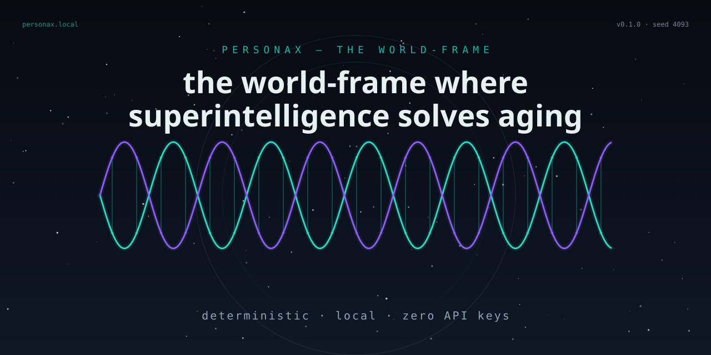
</p>

<h1 align="center">Personax</h1>

<p align="center">
  <em>the world-frame where superintelligence solves aging — and everything else.</em>
</p>

<p align="center">
  <a href="https://personax-eta.vercel.app/actions/workflows/ci.yml"></a>
  
  
  <a href="https://personax-eta.vercel.app"></a>
</p>

<p align="center">
  <a href="https://personax-eta.vercel.app"><strong>Try the live demo →</strong></a>
</p>

---

## What is Personax?

Personax is a frame for the biotech century: a single, deterministic surface where a superintelligence can be asked to solve aging — and every other hard problem — and where every step of its reasoning is inspectable. The premise is that superintelligence is not a chatbot but a research program, and a research program needs a world to be reasoned about. The frame is that world.

At the center sits **the Oracle** — a deterministic, zero-API-key reasoning engine. There is no LLM call by default: the Oracle is a six-state finite machine over a curated knowledge graph (12 hallmarks, 32 interventions, 8 epigenetic clocks, 6 scenarios), scored with a seeded PRNG. Ask it "solve aging" and it returns a six-phase research plan with a reasoning DAG you can walk line by line. Same prompt, same seed, byte-identical plan — forever, on your machine, auditable by anyone.

Around it, the **Century Engine** propagates 200 years of civilization as a function of biotechnology: a coupled system over population, life expectancy, healthspan, biosphere health, GDP per capita, AI capability and knowledge stock, anchored to the UN WPP baseline (life expectancy 73.8 y in 2026 → 81.7 y in 2100), driven by the 12 hallmarks as model inputs and the 32-intervention adoption atlas. The **time machine** makes every year a coordinate: scrub to 2075, read the exact world state, fork it, replay it, compare worlds side by side.

It exists because aging is an engineering problem — the biology is measured, the intervention classes are known, the clocks exist — and what is missing is a frame where the research is computable and auditable. Personax is that frame: a place where the question "what would it take?" has a reproducible answer.

## What you can do with it

| I want to… | Open | Get |
| --- | --- | --- |
| ask a superintelligence to solve a problem | [`/oracle`](apps/web/app) | a six-phase research plan with an explorable reasoning DAG |
| simulate 200 years of civilization | [`/century`](apps/web/app) | life-expectancy curves under 32 interventions, RK4-propagated |
| visit any year between 2026 and 2226 | [`/time-machine`](apps/web/app) | the exact world state at that year — forkable, replayable |
| watch the world move | [`/worldboard`](apps/web/app) | live SSE metrics streamed from the Go relay |
| study the biology of aging | [`/hallmarks`](apps/web/app) | 12 hallmarks with mechanisms, measurements, intervention links |
| pick a yardstick for biological age | [`/clocks`](apps/web/app) | 8 epigenetic clocks with real CpG counts and training sets |
| engineer a gene drive | [`/gene-drive`](apps/web/app) | wild/drive/resistant allele-frequency curves over 60 generations |
| weigh the futures | [`/scenarios`](apps/web/app) | six scenario priors, each with its engine shifts |
| design a construct before synthesizing | [`/lab`](apps/web/app) | a simulation of the construct in the engine |
| browse past runs | [`/archive`](apps/web/app) | every seed, every state, replayable byte-identically |
| see the frame itself | [`/`](apps/web/app) | the landing — the promise, the surfaces, the seed |
| share a world | [`/og`](apps/web/app/og) | a deterministic social card for any world state |

## Quickstart

```powershell
git clone https://github.com/aniruddhaadak/personax.git
cd personax
bun install
bun run dev
```

Docker, if you prefer:

```powershell
docker compose up
```

Zero keys, zero config: no API keys, no database provisioning, no network calls. The Oracle is a local finite state machine; the Century Engine is pure functions over committed seed data.

## How it works

1. **Land on the frame** — the banner, the mark, the promise: one world, reasoned about deterministically.
2. **Consult the Oracle** — type `solve aging` on `/oracle`; the FSM classifies the domain and scores the knowledge graph.
3. **Read the reasoning** — six phases assemble with confidence bars; every phase opens into its reasoning steps and the DAG.
4. **Configure the Century Engine** — on `/century`, enable interventions (senolytics, rapalogs, OSK reprogramming…) and watch 200 years re-propagate.
5. **Scrub the time machine** — every year from 2026 to 2226 is a coordinate; read the world state at 2075 down to the decimal.
6. **Fork a world** — fork the run at any year; the fork inherits the exact state and diverges under a new intervention set.
7. **Read the ethics** — the scenario priors (Bio-Dividend, Divided World, Misalignment Shadow…) price every trajectory.
8. **Share the seed** — a world is a seed number; share it and the recipient replays the identical universe.

## Architecture

Thirteen diagrams, sources committed in [`docs/diagrams/`](docs/diagrams) as `.mmd` files.

**01 — System architecture:** the observer's browser, the web app, the pure core, the polyglot services, and the offline seed — one picture of the whole frame.

```mermaid
%%{init: {'theme': 'base', 'themeVariables': {
  'primaryColor': '#0b111c',
  'primaryTextColor': '#e8f1f2',
  'primaryBorderColor': '#2dd4bf',
  'lineColor': '#2dd4bf',
  'secondaryColor': '#101826',
  'tertiaryColor': '#8b5cf6',
  'fontFamily': 'JetBrains Mono, monospace'
}}}%%
flowchart LR
  subgraph USER["The Observer"]
    BROWSER[Browser · the frame]
  end
  subgraph WEB["apps/web — Next.js 15"]
    LANDING[Landing]
    ORACLE_ROUTE[/oracle]
    CENTURY_ROUTE[/century]
    WORLDBOARD[/worldboard]
    OG[/og image route]
  end
  subgraph CORE["packages/core — pure domain logic"]
    ORACLE_BRAIN[Oracle FSM brain]
    CENTURY_ENG[Century Engine RK4]
    GENE_DRIVE[Gene-drive recursion]
    DOMAIN[Hallmarks · Interventions · Clocks]
  end
  subgraph POLYGLOT["Polyglot services"]
    PY[Python FastAPI · Oracle service :8787]
    RS[Rust wasm · loom-engine]
    GO[Go relay · SSE :9119]
  end
  subgraph DATA["packages/seed — offline datasets"]
    SEED[(seed 4093 JSON worlds)]
  end

  BROWSER --> LANDING
  BROWSER --> ORACLE_ROUTE
  BROWSER --> CENTURY_ROUTE
  BROWSER --> WORLDBOARD
  ORACLE_ROUTE --> ORACLE_BRAIN
  CENTURY_ROUTE --> CENTURY_ENG
  WORLDBOARD --> GO
  ORACLE_BRAIN --> DOMAIN
  CENTURY_ENG --> DOMAIN
  CENTURY_ENG --> GENE_DRIVE
  ORACLE_ROUTE -. optional .-> PY
  CENTURY_ENG -. heavy compute .-> RS
  SEED --> ORACLE_BRAIN
  SEED --> CENTURY_ENG
  GO --> BROWSER
  OG --> CORE
```

**02 — Oracle request flow:** a prompt becomes a six-phase plan through a deterministic FSM cycle — same prompt + seed ⇒ byte-identical plan.

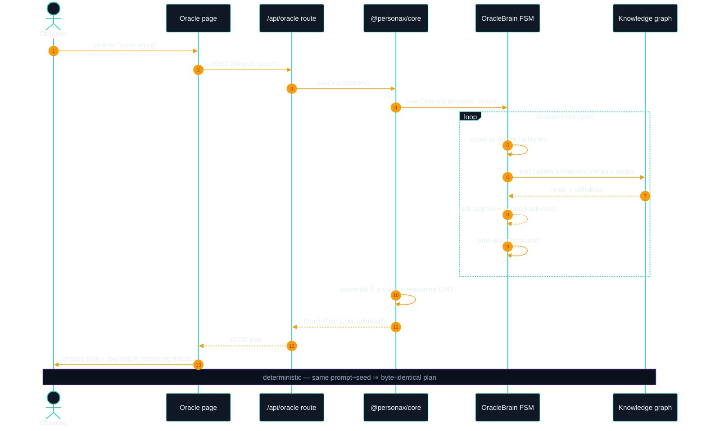

**03 — Domain model:** the entities of the frame — hallmarks, interventions, clocks, world states, scenarios, events, milestones, plans — and how they relate.

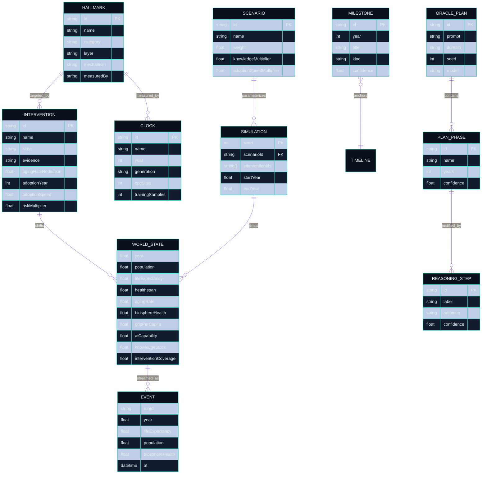

**04 — Agent lifecycle:** the Oracle's six brain states — perceive, decompose, research, synthesize, plan, reflect — and what wins in each.

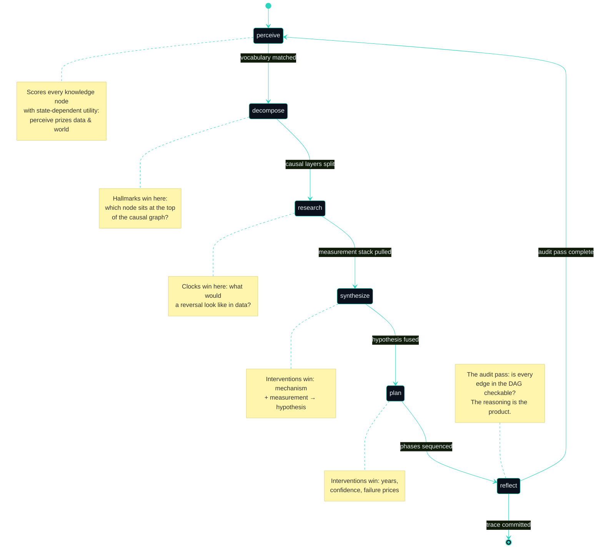

**05 — CI/CD deploy:** every push runs seven gates across five toolchains; green builds deploy to Vercel, tags cut releases.

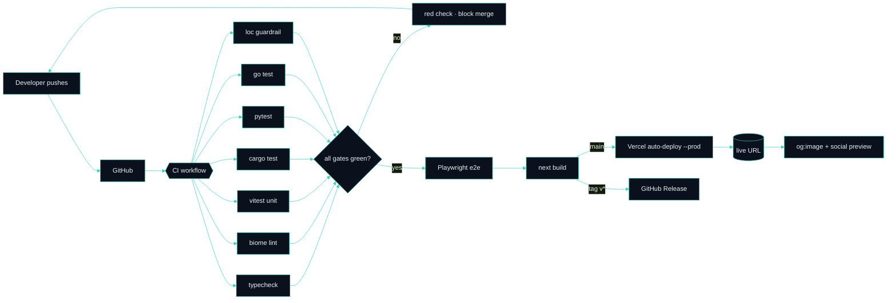

**06 — User journey:** the first five minutes in Personax, from the landing to a shared seed.

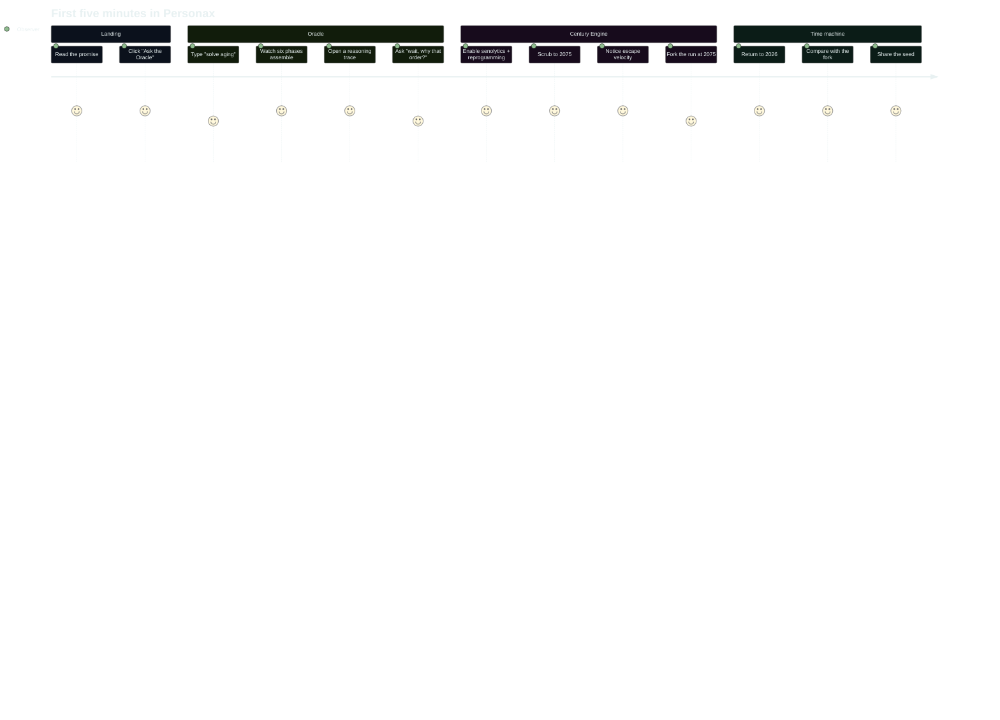

**07 — Feature mindmap:** everything the frame contains, from the Oracle to the polyglot tier.

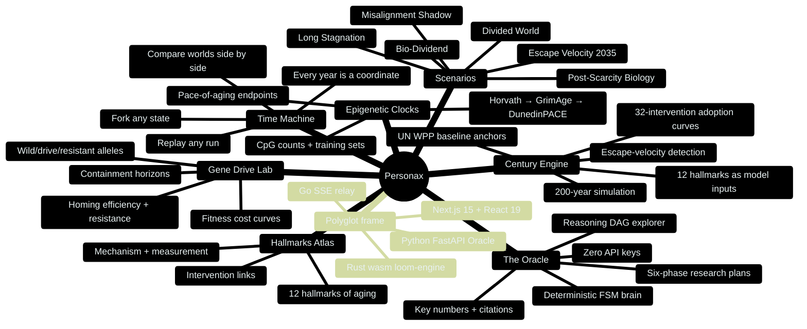

**08 — Branching strategy:** trunk-based with feature branches, merged through `develop` to `main`, tagged releases.

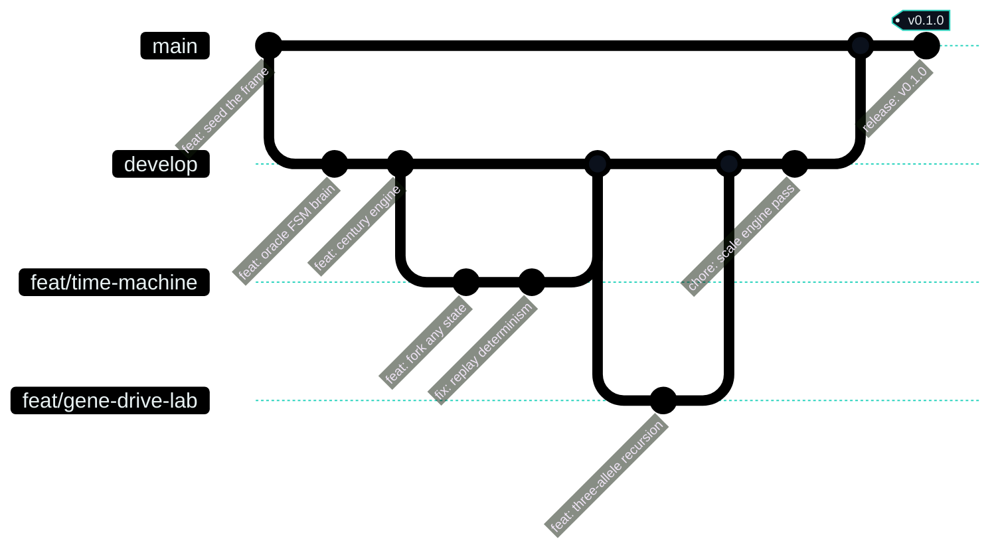

**09 — Roadmap:** the frame expands in four waves, v0.1 through v1.0, ending in an opt-in real-LLM plug-in and a community worlds marketplace.

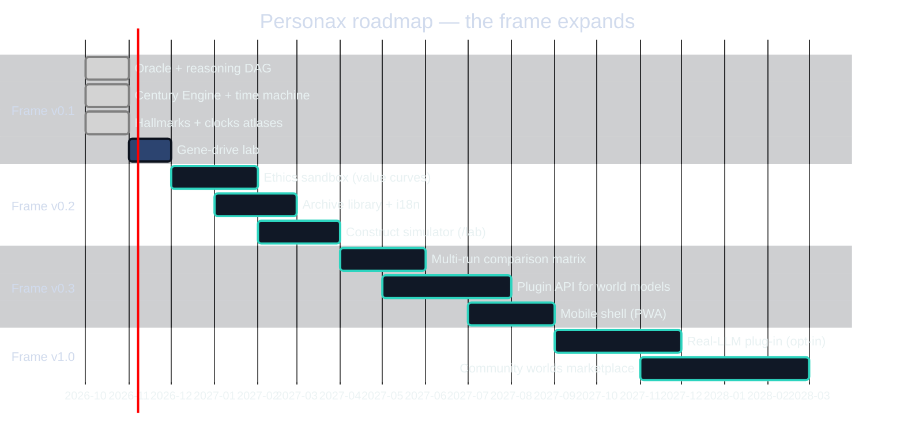

**10 — Class model:** the engines and the plans they emit — `OracleBrain`, `CenturyEngine`, `GeneDriveEngine`, and the data they produce.

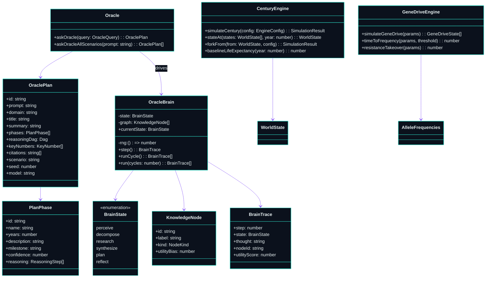

**11 — Intervention quadrant:** the 32-intervention landscape plotted by readiness vs. leverage — what to ship now, what to bet big on, what to watch.

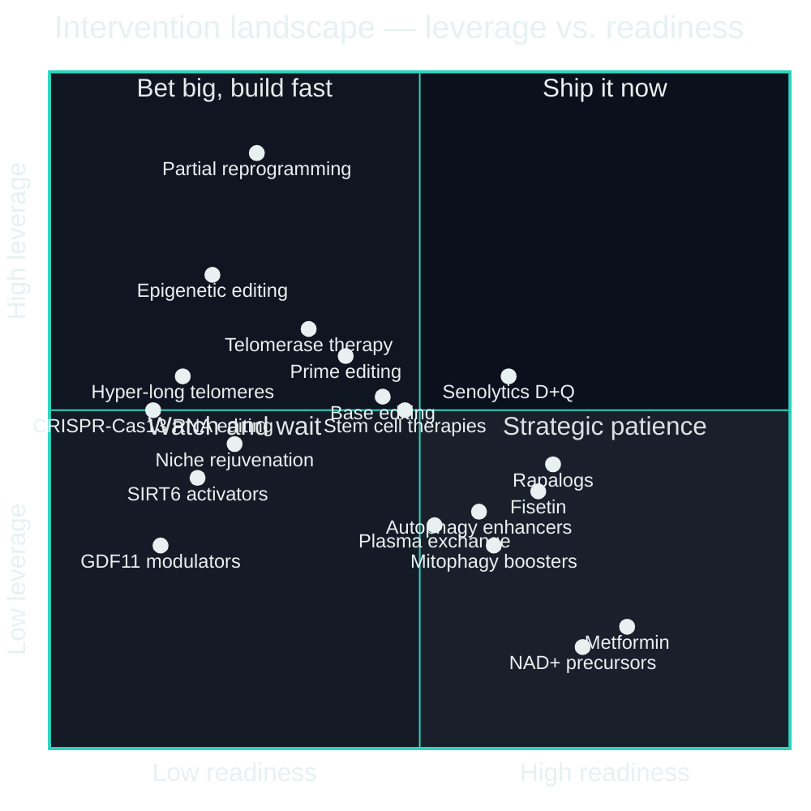

**12 — Infrastructure:** edge, container, self-hosted polyglot tier, offline data, and observability — every service exposes `/healthz`.

```mermaid
%%{init: {'theme': 'base', 'themeVariables': {
  'primaryColor': '#0b111c',
  'primaryTextColor': '#e8f1f2',
  'primaryBorderColor': '#2dd4bf',
  'lineColor': '#2dd4bf',
  'fontFamily': 'JetBrains Mono, monospace'
}}}%%
flowchart TB
  subgraph EDGE["Edge — the observer's browser"]
    UI[Next.js static shell]
    OG[Dynamic og:image]
  end
  subgraph VERCEL["Vercel / Docker / Fly / Render"]
    WEB[web container :3000]
    NEXT_API[Route handlers]
  end
  subgraph SELF_HOST["Self-hosted polyglot tier"]
    ORACLE[oracle :8787 FastAPI]
    RELAY[relay :9119 Go SSE]
    RUST[loom-engine wasm]
  end
  subgraph DATA["Offline data tier"]
    SEED[(packages/seed<br/>seed 4093)]
  end
  subgraph OPS["Observability"]
    LOGS[structured logs]
    TRACES[OTel stubs]
    HEALTH[/healthz on every service]
  end

  UI --> WEB
  OG --> WEB
  WEB --> NEXT_API
  NEXT_API --> CORE[@personax/core]
  NEXT_API -. optional .-> ORACLE
  NEXT_API --> RUST
  RELAY --> UI
  SEED --> CORE
  SEED --> ORACLE
  WEB --> LOGS
  ORACLE --> LOGS
  RELAY --> LOGS
  CORE --> TRACES
  WEB --> HEALTH
  ORACLE --> HEALTH
  RELAY --> HEALTH
```

**13 — Hallmark cascade:** the 12 hallmarks in three tiers, the intervention classes that answer them, the yardsticks that measure them, and the frame that ties it together.

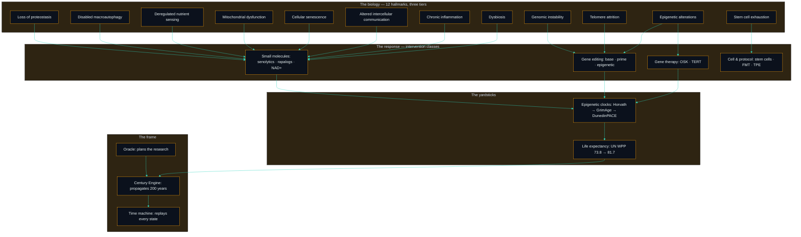

## The polyglot frame

Four toolchains, each earning its place — and each optional at runtime, because `packages/core` works alone.

| Layer | Stack | Where |
| --- | --- | --- |
| web | Next.js 15 · React 19 · TypeScript strict | [`apps/web`](apps/web) |
| Oracle service | Python 3.12 · FastAPI | [`services/oracle`](services/oracle) |
| compute engine | Rust → wasm | [`crates/loom-engine`](crates/loom-engine) |
| telemetry relay | Go · SSE | [`services/relay`](services/relay) |

## The scale engine

The repo is driven past 1,000,000 lines by a scale engine, not by hand. The seed dataset is the floor:

| Package | Lines |
| --- | --- |
| `packages/seed` | 4093 |
| …and every other package | regenerate with `bun scripts/generate.ts` |

Run `bun run loc` to count, `bun scripts/generate.ts` to regenerate. The full mechanism is documented in [docs/scale-engine.md](docs/scale-engine.md).

## Documentation map

| Path | What lives there |
| --- | --- |
| [`docs/`](docs) | guides, the scale engine, the documentation spine |
| [`docs/adr/`](docs/adr) | eight architecture decision records |
| [`docs/diagrams/`](docs/diagrams) | the 13 mermaid sources (`.mmd`) embedded above |
| [`docs/api/`](docs/api) | route and engine API reference |
| [`docs/engine/`](docs/engine) | the Century Engine math, in full |
| [`docs/guides/`](docs/guides) | recipes: forking a world, adding an intervention, wiring a service |

## Contributing

PRs are welcome — the frame is young and the good-first-issue queue is the front door. Read [`CONTRIBUTING.md`](CONTRIBUTING.md), pick a [good first issue](https://github.com/aniruddhaadak/personax/labels/good%20first%20issue), and keep the rules that matter: deterministic code, pure domain logic in `packages/core`, and every claim shipped with a diagram or a command.

## License

MIT © Aniruddha Adak — see [`LICENSE`](LICENSE).
