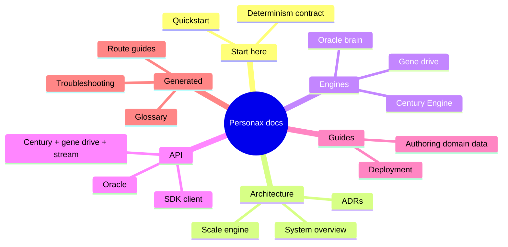

# Personax documentation

## Start here

- [`guides/quickstart.md`](guides/quickstart.md) — clone to running app in five commands
- [`guides/determinism.md`](guides/determinism.md) — the byte-identical guarantee and how it is enforced

## Architecture

- [`architecture.md`](architecture.md) — the whole frame in one page
- [`scale-engine.md`](scale-engine.md) — `bun run generate` and its 83 outputs
- [`adr/`](adr/) — nine architecture decision records

## Engines

- [`engine/century-engine.md`](engine/century-engine.md) — the coupled system, its formulas, its limits
- [`engine/gene-drive.md`](engine/gene-drive.md) — the three-allele recursion and containment
- [`engine/oracle-brain.md`](engine/oracle-brain.md) — the six-state FSM behind every plan

## API

- [`api/oracle.md`](api/oracle.md) — `POST /api/oracle`
- [`api/century.md`](api/century.md) — `/api/century/simulate`, `/api/gene-drive`, `/api/stream`
- [`api/sdk.md`](api/sdk.md) — the typed client and its guarantees

## Guides

- [`guides/deployment.md`](guides/deployment.md) — Vercel, Docker, Fly, Render, Railway
- [`guides/authoring-domain-data.md`](guides/authoring-domain-data.md) — adding interventions, hallmarks, clocks, scenarios

## Generated reference (do not edit — regenerate)

- [`generated/apps-web-routes/`](generated/apps-web-routes/) — a page per route
- [`generated/glossary/`](generated/glossary/) — the biology, defined
- [`generated/troubleshooting.md`](generated/troubleshooting.md) — the runbook

## Diagrams

Thirteen mermaid sources live in [`diagrams/`](diagrams/) and are embedded in
the README; the architectural SVG renders are in [`images/`](images/).
